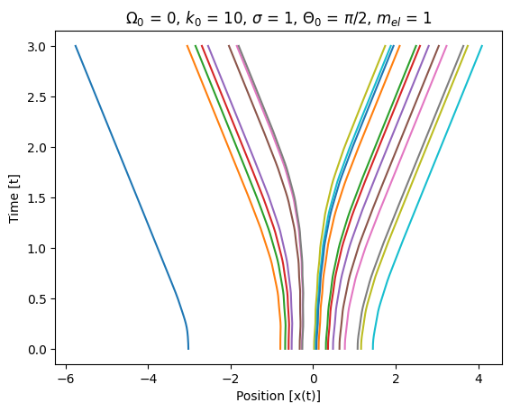
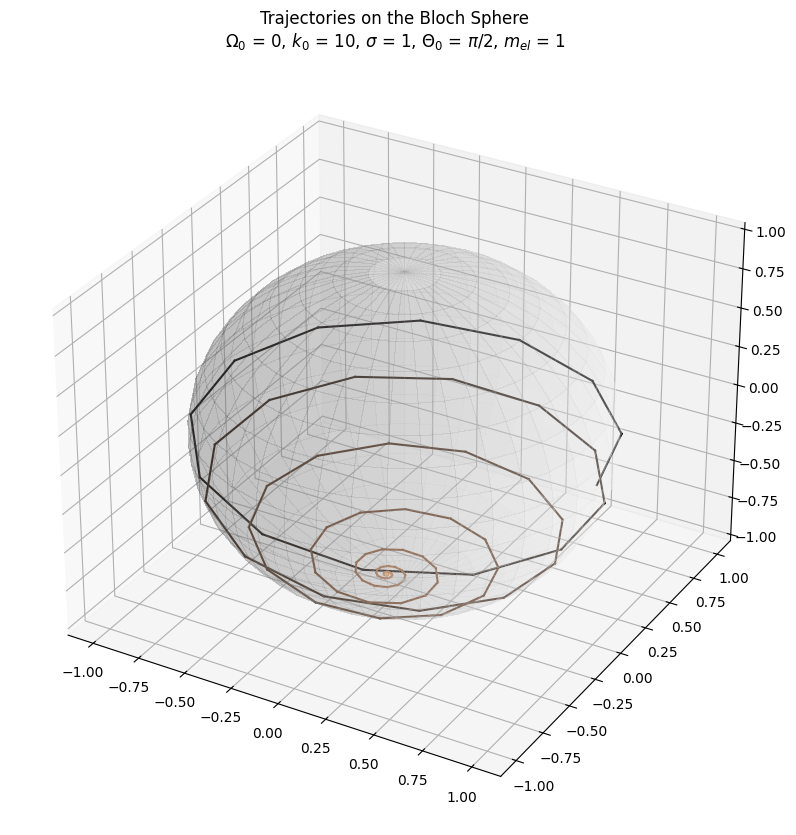

# Bohmian Trajectories of a Dirac Electron in One Space Dimension

[](https://arxiv.org/abs/2512.21423)

Python code for simulating the trajectories of an electron in one space dimension, guided by a
spin-½ wave function that evolves under the free Dirac equation. The initial wave function is a
Gaussian wave packet, and the particle moves along the integral curves of the Bohmian velocity
field built from that wave function.

This code was used to generate the figures in the paper

> K. Narayanan, A. Perryman, and A. S. Tahvildar-Zadeh,
> **Asymptotic Momentum of Dirac Particles in One Space Dimension**,
> [arXiv:2512.21423](https://arxiv.org/abs/2512.21423).

<p align="center">
  
  
  
</p>
<p align="center"><em>
Left: trajectories x(t). Middle: the spinor of one trajectory on the Bloch sphere.
Right: animated histogram of the momenta of 100 trajectories.
All generated with <code>k = 10, m = 1, σ = 1, θ = π/2, ω = 0</code>.
</em></p>

## Contents

- [Background](#background)
- [Features](#features)
- [Installation](#installation)
- [Quick start](#quick-start)
- [Parameters](#parameters)
- [Function reference](#function-reference)
- [Output files](#output-files)
- [Performance notes](#performance-notes)
- [Conventions and caveats](#conventions-and-caveats)
- [Citation](#citation)

## Background

Units are ħ = c = 1. The wave function is a two-component spinor ψ = (ψ₋, ψ₊) (called g1 and h1 in
the code) that solves the free Dirac equation in one space dimension,

$$(\partial_t + \partial_x) \psi_- = -i m \psi_+, \qquad (\partial_t - \partial_x) \psi_+ = -i m \psi_-.$$

**Initial data.** A Gaussian packet with mean momentum $k$ and width $\sigma$, with a spinor
described by two Bloch-sphere angles $(\Theta, \Omega)$:

$$\mathring{\psi}(x) = \begin{pmatrix}
     \cos\frac{\Theta_0}{2}e^{i\Omega_0/2}\\ 
     \sin\frac{\Theta_0}{2}e^{-i\Omega_0/2}
 \end{pmatrix} \frac{1}{\sqrt[4]{2\pi \sigma^2}} e^{-\frac{x^2}{4\sigma^2} + ik_0s}.$$

**Exact solution.** The solution is computed in closed form with Bessel kernels
with $\rho = \sqrt{t^2-(x-r)^2}$ and both integrals over $r \in [x-t,s+t]$:

$$\psi_{\pm}(t,x) = \mathring{\psi_{\pm}}(x \pm t) - \frac{\omega }{2}\int_{x-t}^{x+t}J_1\left(\omega\sqrt{t^2 - (x - \sigma)^2}\right)\frac{\sqrt{t \mp (x- \sigma)}}{\sqrt{t \pm (x- \sigma)}}\mathring{\psi_{\pm}}(\sigma) \,d\sigma\nonumber - \frac{i\omega}{2} \int_{x-t}^{x+t} J_0\left(\omega\sqrt{t^2 - (x - \sigma)^2}\right) \mathring{\psi_{\mp}}(\sigma) d\sigma.$$

**Trajectories.** The particle's position solves $\dot{x} = j_1/j_0$, where
$j_0 = |\psi_-|^2+|\psi_+|^2$ is the probability density and $j_1 = |\psi_-|^2-|\psi_+|^2$ the probability current.
Initial positions are sampled from $j_0(x,0)$, which is a Gaussian with standard deviation $\sigma$.

**Bloch-sphere variables.** Writing $\psi_- = R\cos(\Theta/2)e^{i(\Phi-\Omega)/2}$ and
$\psi_+ = R\sin(\Theta/2)e^{i(\Phi+\Omega)/2}$ gives the variables $(R, \Theta, \Omega, \Phi)$. The
velocity is $v = \cos\Theta$. The momentum and energy of a trajectory are:

$$p = m\cot\Theta\sec\Omega, \qquad E = m\csc\Theta\sec\Omega.$$

**What the paper shows.** At large times the wave function is approximately a superposition of two
wave packets traveling in opposite directions. The trajectories then have approximately constant
asymptotic momentum $k$ and asymptotic energy $\pm\sqrt{m^2+k^2}$. The sign of the energy is
determined by the particle's initial position, and negative-energy particles move in the direction
opposite to their momentum. The simulations here let you watch this happen: for example, the
momentum histogram collapses onto $p \approx k.$

## Features

- **Trajectory simulation.** Draw N starting positions from the initial density (or supply your own)
  and evolve them under the exact Bohmian velocity field.
- **Velocity, momentum and energy plots.** Plot x(t), or the velocity, momentum, energy (and their
  signed-log versions) of each trajectory against time.
- **Momentum histograms and GIFs.** Histogram the momenta of N trajectories at every time step and
  save an animation. The canonical momentum distribution and its positive/negative-energy parts can
  be overlaid.
- **Bloch-sphere plots.** Trajectories on the Bloch sphere, final positions of an ensemble, and the
  time evolution of R, Θ, Ω and Φ.
- **Diagnostics.** Plots of the density, current and velocity field, a check that the total
  probability stays equal to 1, and an independent FFT solver to cross-check the closed-form
  solution.
- **Reproducible.** Every sampling function takes a `seed`, and every plot can be saved as a PNG
  with `save_image=True`.

## Installation

The code needs Python 3 and four packages: NumPy, SciPy, Matplotlib and Pillow (for GIFs). It was
developed with Python 3.12.

```bash
git clone https://github.com/abbyperryman/1ddiracparticles.git
cd 1ddiracparticles
pip install -r requirements.txt
```

## Quick start

Create an `InitialParameters` object with the physical parameters and pass it to the functions you
want to use:

```python
from numpy import pi
from dirac_particles_code import (
    InitialParameters, plotTrajectories, plotTrajectoryMomenta,
    momentum_animation, plotOnBlochSphere,
)

params = InitialParameters(k=10, m_el=1, theta=pi / 2, omega=0, sigma=1)

plotTrajectories(4, params, N=20, seed=0, save_image=True)   # 20 sampled trajectories up to t = 4
plotTrajectories(4, params, x_init=[-1.0, 0.0, 1.0])         # or choose the starting points
plotTrajectoryMomenta(4, params, N=10, seed=0)               # momentum of each trajectory vs. time
momentum_animation(4, params, N=200, seed=0, frame_step=4)   # histogram GIF, saved to MomentumAnimations/
plotOnBlochSphere(0.3, params, tmax=4)                       # one trajectory on the Bloch sphere
```

To start in a free-particle energy eigenstate instead of choosing `theta` and `omega` yourself:

```python
params = InitialParameters(k=10, m_el=1, sigma=1, eigenstate=+1)   # +1: E = +sqrt(k^2 + m^2)
```

Running `python dirac_particles_code.py` executes the example at the bottom of the file, under
`if __name__ == "__main__":`. Edit that block to run whatever you like.

## Parameters: the `InitialParameters` class

```python
InitialParameters(k, m_el, theta=None, omega=None, sigma=1, eigenstate=None)
```

| Parameter | Meaning | Notes |
|---|---|---|
| `k` | Mean momentum ("mean frequency" k₀) of the Gaussian packet | Either sign is supported. |
| `m_el` | Electron mass | Must be positive. Units with ħ = c = 1. |
| `theta` | Mixing angle θ, the polar Bloch angle of the initial spinor | Default π/2. See [angle reduction](#conventions-and-caveats). |
| `omega` | Second initial Bloch angle ω | Default 0. The initial Bloch azimuth is Ω₀ = −ω. |
| `sigma` | Standard deviation σ of the initial Gaussian in position | Default 1; must be positive. The canonical momentum distribution has standard deviation 1/(2σ). |
| `eigenstate` | `+1` or `-1` to start in the energy eigenstate at momentum `k` | Sets `theta` and `omega` for you, so it cannot be combined with them. |

With `eigenstate=+1` the initial spinor is the free-particle eigenstate with energy +√(k²+m²), and
with `eigenstate=-1` it is the one with energy −√(k²+m²). The plot titles label these cases Θ₊
and Θ₋.

An instance also provides:

| Member | What it is |
|---|---|
| `params.k`, `params.m_el`, `params.sigma`, `params.theta`, `params.omega` | The parameters (after angle reduction). |
| `params.Omega0` | The initial Bloch azimuth, −ω. |
| `params.title` | The plot title describing the parameters. |
| `params.eigenstate_label` | `'pos'` or `'neg'` if the initial spinor is an energy eigenstate at momentum `k`, otherwise `'none'`. |
| `params.eigenstate_angles(branch)` | The `(theta, omega)` of the eigenstate with `branch=+1` or `-1`. |
| `params.param_tag()` | The string used in output file names, e.g. `k=10_theta=1.5707_omega=0_m=1_sigma=1`. |

Treat an instance as read-only. The labels recompute if you change an attribute, but the angle
reduction only runs when the object is created. Create a new `InitialParameters` instead.

## Function reference

Every function that depends on the physical parameters takes a `params` argument. By convention it
comes right after the function's required arguments and before its optional ones, as in
`plotTrajectories(t, params, x_init=None, N=20, ...)`.

Starting positions can be given explicitly with `x_init`; if it is left out, `N` positions are
drawn from the initial density, optionally with a `seed`. Every plotting function takes
`save_image=False`.

### Trajectories

| Function | What it does |
|---|---|
| `plotTrajectories(t, params, x_init=None, N=20, seed=None)` | Plots x(t) for each trajectory and prints the mean final momentum and energy. |
| `plotSpecificTrajectories(t, xlist, params)` | Same plot for an explicit list of starting positions. |
| `plotTrajectoryVelocities(t, params, ...)` | Velocity (cos Θ) of each trajectory against time. |
| `plotTrajectoryMomenta(t, params, ...)` | Momentum of each trajectory against time. |
| `plotTrajectoryEnergies(t, params, ...)` | Energy of each trajectory against time. |
| `plotTrajectoryLogMomentum(t, params, ...)`, `plotTrajectoryLogEnergy(t, params, ...)` | Signed-log versions, sign(·)·log(\|·\|+1), for quantities that span orders of magnitude. |
| `rk4(params, x0=None, n=1000, t_max=5)` | One trajectory and its momentum, integrated with a hand-written RK4 loop. |

### Momentum histograms and animations

| Function | What it does |
|---|---|
| `momentum_animation(t, params, N=100, x_init=None, ...)` | Animated histogram of the momenta of N trajectories, saved as a GIF. |
| `animate_j0(params, t_max=3, n_frames=30, ..., save_gif=False)` | Animates the probability density j₀(x, t). |

`momentum_animation` has a fixed, wide x-axis (centered on `k` by default) so that you can follow
how the histogram moves. It overlays the canonical momentum distribution N·|φ(p)|², and with
`show_branches=True` its positive- and negative-energy parts. Useful options:

| Option | Default | Meaning |
|---|---|---|
| `method` | `"grid"` | `"grid"` integrates the trajectories on an FFT grid (fast); `"quad"` uses the Bessel-kernel solution with quadrature. |
| `p_range` | `None` | Fixed momentum axis `(lo, hi)`. By default the axis is computed from the trajectories. |
| `center_on_k` | `True` | Make the automatic axis symmetric about `k`. |
| `coverage`, `margin` | `0.95`, `0.1` | Fraction of the momenta the automatic axis must cover, and its padding. |
| `fixed_y` | `True` | Keep the y-axis fixed (`False` rescales each frame). |
| `frame_step` | `1` | Draw every n-th time step; larger values render faster and give shorter GIFs. |
| `fps`, `n_bins`, `seed` | `10`, `400`, `None` | Frame rate, number of histogram bins, random seed. |

### Bloch sphere

| Function | What it does |
|---|---|
| `plotOnBlochSphere(x0, params, tmax=4)` | Spinor of the trajectory starting at `x0`, drawn on the Bloch sphere and colored by time. |
| `plotFinalPosOnBlochSphere(t, params, N=100, seed=None)` | Final Bloch-sphere positions of N trajectories. |
| `plotTimeEvolutionofBlochVars(x0, t, params)` | R, Θ, Ω and Φ against time for the trajectory starting at `x0`. |

### Wave function and diagnostics

| Function | What it does |
|---|---|
| `plotProbabilityCurrentsAndVelocity(t, params)` | Plots j₀, j₁ and the velocity field v as functions of x at time t. |
| `plotWaveFunc(choice, t, params, N=200, seed=None)` | Scatter plot of Re ψ₋ (`choice=0`) or Re ψ₊ (`choice=1`) at time t. |
| `probability_check(t_max, params)` | Plots ∫ j₀ dx against time; it should stay equal to 1. |
| `verify_solution(params, t=1.0, x_target=0.3)` | Difference between the closed-form solution and the independent FFT solver. |

### Lower-level building blocks

`g1(x, t, params)`, `h1(x, t, params)` and `amplitudes(x, t, params)` give the exact spinor;
`j0`, `j1`, `v`, `polar_decomp`, `p` and `e`, all called as `f(x, t, params)`, give the observables;
`exact_spinor_grid(t, params)` is the FFT solver;
`grid_bohmian_trajectories(x_init, T, params)` is the fast trajectory integrator;
`canonical_momentum_density(q, params, branch=None)` and `positive_energy_weight(params, branch=+1)`
describe the momentum-space distribution of the packet;
`sample_initial_positions(N, params, seed=None)` draws starting points.

## Output files

With `save_image=True`, each plot is saved as a PNG in a subdirectory next to the script. The
directories are created automatically, and file names include the parameters (`k`, `theta`, `omega`,
`m`, `sigma`) so runs with different parameters do not overwrite each other.

| Directory | Contents |
|---|---|
| `ElectronTrajectoriesImages/` | `plotTrajectories`, `plotSpecificTrajectories`, `rk4` |
| `VelocityImages/`, `MomentumImages/`, `EnergyImages/` | The velocity, momentum and energy plots, including the log versions |
| `BlochSphereImages/`, `BlochVariableImages/` | The Bloch-sphere plots |
| `WaveFunctionImages/`, `ProbabilityCurrentsVelocityImages/`, `ProbabilityCheckImages/` | The wave function and diagnostic plots |
| `MomentumAnimations/` | GIFs from `momentum_animation` (always saved) |
| `DensityAnimations/` | GIFs from `animate_j0(..., save_gif=True)` |

## Performance notes

- `momentum_animation` uses the fast grid integrator by default. For 100 trajectories up to t = 4
  the integration takes under a second, and most of the run time is spent rendering GIF frames
  (roughly 0.2 s per frame). Use `frame_step` to cut that.
- The other trajectory plots use adaptive quadrature of the closed-form solution, which takes on the
  order of seconds per trajectory at t = 4 with `k = 10`. Keep `N` modest for those.
- `method="quad"` in `momentum_animation` gives the same results as the default but is much slower.

## Conventions and caveats

- **Initial azimuth.** The first spinor component carries `exp(+iω/2)` and the second
  `exp(−iω/2)`, so the initial Bloch azimuth is Ω₀ = −ω. This only matters when ω is not 0 or π.
- **Angle reduction.** `InitialParameters` accepts any real `theta` and `omega` and reduces them to
  an equivalent pair with θ in [0, π] and ω in (−π, π]. "Equivalent" means the same spinor up to a
  global phase, which does not change the Bohmian dynamics. For example, `theta=-0.5` is stored as
  `theta=0.5, omega=π`, which is a different pair of numbers but the same physical state. Angles
  that are already in range are left unchanged.
- **Initial momentum.** The momentum `p = m cot Θ sec Ω` is computed from the spinor, not from `k`.
  For a generic initial spinor it is *not* `k` at t = 0. With θ = π/2 and ω = 0, for example, every
  trajectory starts at p = 0 and approaches `k` only after a few time units. To start at `k`, create
  the parameters with `eigenstate=+1`.
- **Singularities.** `p` and `E` diverge where cos Ω = 0, so individual trajectories can show large
  spikes at intermediate times. The histogram animation counts the trajectories that fall outside
  the plotted range in each frame.
- **Canonical vs. Bohmian momentum.** The dotted curve in the animation is the distribution of the
  canonical momentum, a Gaussian with mean `k` and standard deviation 1/(2σ) that does not change in
  time. It is a different quantity from the Bohmian momentum shown by the bars.
- **Domain size.** `exact_spinor_grid` and `grid_bohmian_trajectories` use a periodic grid that is
  sized automatically from `t` and `sigma`.

## Citation

If you use this code, please cite the paper:

```bibtex
@misc{narayanan2025asymptotic,
  title         = {Asymptotic Momentum of Dirac Particles in One Space Dimension},
  author        = {Narayanan, Kabir and Perryman, Abigail and Tahvildar-Zadeh, A. Shadi},
  year          = {2025},
  eprint        = {2512.21423},
  archivePrefix = {arXiv}
}
```

## Authors

Code by Abigail Perryman. The accompanying research is joint work with Kabir Narayanan and
A. Shadi Tahvildar-Zadeh.
